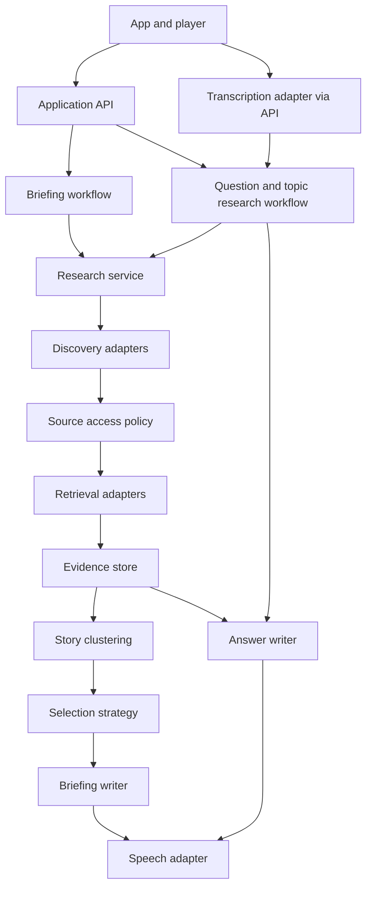

# toldAI backend architecture

Decision date: 2026-10-18. Status: architecture proposal for implementation.

The core product is five stories matched to the listener's interests, with short original summaries, linked evidence, and audio. The listener can press Ask to discuss a story or search for a specific topic. Sourcing and story selection are core product capabilities and must be easy to improve without rebuilding the player or replacing the whole backend.

## Initial product contract

- Generate up to five distinct stories based on interests and listening history. V1 uses English text and voice input/output; persist language and optional location for future expansion. Target five, but return fewer with an explanation when sufficient evidence is unavailable.
- Present what happened, why it matters, and any material uncertainty, with supporting source links and dates.
- Keep text useful independently of audio. A speech-generation failure must not hide a researched story.
- Press Ask pauses playback. Support typed questions and recorded voice questions, followed by multiple explicit follow-up turns. Continue returns to the briefing.
- Support standalone topic research through the same research capabilities used by briefing questions.
- Keep generation status, source availability, and failures visible. Search snippets are discovery material, not proof of access to the full article.

## Deployment shape

Start with a modular monolith: one backend codebase, an API process, and a background worker using the same application modules. Use a relational database for durable state, object storage for audio, and a durable job queue. Selected stack: native SwiftUI client, TypeScript backend, Supabase for Postgres/Auth/Storage, OpenAI for LLM functions, and ElevenLabs for speech. Backend framework and worker hosting remain implementation choices.

Modules communicate through typed application interfaces. Each module owns its writes; other modules use its public interface. Database access and vendor SDKs stay behind adapters. The player consumes stable application responses and never depends on a search provider's or speech provider's response format.

This provides component boundaries for experiments while keeping initial deployment and debugging manageable. Split a module into a separate service only when workload, scaling, or operational needs justify it.



## Module boundaries

| Module | Owns | Replaceable techniques |
|---|---|---|
| Preferences and history | Saved interests, optional country/city, input/output language, explicit feedback, heard story versions | Explicit topics initially; inferred preferences later |
| Source registry and access policy | Source identity, permitted operations, attribution and retention requirements | Manual source configuration initially; licensed connectors later |
| Discovery | Candidate URLs and metadata from queries or feeds | Search API, RSS, supplier feed, scheduled crawling where permitted |
| Retrieval | Fetching, extraction, canonical URLs, access outcomes | HTML extractor, publisher API, document parser |
| Evidence | Retrieved material and supported claims with provenance | Extraction prompts, evidence validation, storage/indexing approach |
| Story clustering | Grouping reports about the same event; identifying new developments | Rules, embeddings, LLM-assisted comparison |
| Selection | Choosing and ordering up to five stories with recorded reasons | Simple scoring, LLM ranking, hybrid ranking |
| Composition | Story cards, scripts, answer text, evidence references | Model, prompt, single-host or two-host presentation |
| Speech and transcription | Audio generation, timing metadata, voice transcription | ElevenLabs selected for speech; model/voice configurable behind an adapter |
| Conversation | Turns, research decisions, cancellation, session context | Answer from existing evidence or perform bounded new research |
| Workflow execution | Jobs, retries, progress, budgets, experiment configuration | Queue/runtime implementation |

The research agent orchestrates these tools. It does not own source policy, billing limits, database credentials, or playback state. Retrieved pages are untrusted content and cannot authorize actions or change tool permissions.

## Core interfaces

These signatures describe boundaries, not a committed implementation language. Every remote operation receives a request context containing identity, deadline, cancellation signal, tracing ID, and cost budget.

```text
discover(query, filters, context) -> Candidate[]
checkAccess(source, operation, context) -> AccessDecision
retrieve(candidate, accessDecision, context) -> RetrievalResult
extractEvidence(documentVersion, context) -> EvidenceBundle
cluster(evidenceBundles, existingStories, context) -> StoryVersion[]
select(stories, preferences, listeningHistory, count, context) -> Selection
composeBriefing(selection, evidence, context) -> BriefingDraft
answer(question, conversation, evidence, context) -> AnswerDraft
synthesize(scriptVersion, voiceConfig, context) -> AudioSegmentStream
transcribe(recording, context) -> Transcript
```

Normalize provider output at the adapter boundary and validate the application schema before storing or publishing it. Candidate metadata, retrieved content, evidence, generated text, and audio are separate objects. A successful search result is not a successful retrieval; a successful retrieval does not itself approve downstream use.

## Data model and provenance

| Record | Essential information |
|---|---|
| User profile | Owner ID, interests, optional country/city, input/output language fixed to English in v1, version, updated time |
| Source | Identity, domain, connector, policy version, permitted uses, attribution, retention |
| Candidate | URL, title, discovery provider, query, discovered time, claimed publication time |
| Document version | Canonical URL, publisher, author if available, publication/retrieval times, content hash, access status, permitted content reference |
| Evidence bundle | Claims, supporting document locations, origin of reporting, conflicts, missing information |
| Story version | Stable event ID, version, headline, event time, topics, evidence IDs, changes from previous version |
| Selection run | Candidate story versions, eligibility exclusions, scores/reasons, selected order, preferences/history snapshot references |
| Briefing | Owner, ordered story version IDs, generation state, script version IDs, creation time |
| Script and audio | Script version, language, evidence references, voice/model configuration, audio segments and timing metadata |
| Conversation and turn | Owner, story version or standalone topic, prior turns, evidence IDs, turn status, answer version |
| Playback progress | Owner, briefing/story/script version, segment and offset, completed stories, resume checkpoint |
| Research run | Queries, tool calls, provider/model/prompt versions, budgets, latency, usage, failures |

Freeze the evidence and story versions used in a published briefing. New research creates a new version instead of silently changing an already generated episode. Store article bodies only as permitted; retention expiry must also cover derived caches or indexes where required. Keep provenance metadata where allowed even when full text expires.

Treat user conversations, recordings, preferences, and personalized artifacts as private. Check ownership on every request and media access. Share public research caches only where source permissions allow; do not put private user queries or licensed user-specific content into shared caches.

## First selection strategy

Start with an inspectable baseline and a small configured source set:

1. Discover recent candidates for the user's explicit interests.
2. Apply source/access eligibility and retrieve usable material.
3. Extract claims and group reports into events. Track shared wire origins so repeated reporting is not mistaken for independent confirmation.
4. Exclude unsupported stories and already-heard versions without meaningful developments.
5. Rank by interest relevance, significance, freshness, evidence strength, and novelty. Save each component and the reason for selection.
6. Select up to five with topic and source-diversity constraints and a total listening-time budget.
7. Compose from the selected evidence; preserve conflicting accounts and attribute single-source claims. Do not fill missing evidence from model memory.

Weights, diversity limits, freshness windows, and minimum evidence requirements are versioned configuration. Their initial values should be tuned against reviewed examples, not treated as established measures of quality. Premium access status is not a quality score.

## Three workflows using shared capabilities

**Five-story briefing:** preferences → discovery → permitted retrieval → evidence → clustering → selection → story cards → scripts → audio. Return cards as soon as ready; generate audio per story so the whole briefing does not need to finish before listening starts.

**Question about a story:** pause immediately on the client → submit text or transcribe recording → load the pinned story evidence and conversation → decide whether evidence is sufficient → run bounded additional research if needed → compose a grounded answer → stream speech in ordered segments. Show research progress while waiting. Permit another explicit question after the answer; Continue resumes the briefing from its saved checkpoint.

**Specific-topic search:** submit a query → research using the same discovery, retrieval, and evidence modules → return a concise answer with sources and optional audio → allow follow-ups. This does not require creating a persistent custom show.

The client owns immediate transport controls and saves its checkpoint durably. Continuing should use a sentence boundary when timing metadata is available and the saved offset otherwise. Cancellation invalidates the active turn ID; late text/audio from that turn must be discarded. Only one audio stream may play at a time.

## Reliability and operational controls

- Persist jobs with queued, running, succeeded, failed, and cancelled states. Use idempotency keys to avoid duplicate briefings or audio on retried requests.
- Retry transient provider failures with bounded backoff. Do not retry denied access as a different retrieval method. Surface unavailable or insufficient evidence as explicit outcomes.
- Cap searches, fetched pages, model tokens, audio duration, elapsed time, and spend per research run. The server enforces limits independently of the agent.
- Key permitted caches by content/script version, language, voice, model, and policy as appropriate. A changed source policy invalidates affected eligibility and cached uses.
- Make job completion, UI reconnect, and stale events safe: events include run/turn ID, sequence, and status; clients can fetch authoritative state after reconnecting.
- Record time to story cards, first audio, and first spoken answer separately. Compare questions answered from existing evidence with questions requiring web research.
- Keep credentials server-side. Validate fetched URLs and redirects to block private-network access, enforce payload limits, and sanitize extracted content.

## Experiments without rewriting the app

Each run resolves one versioned configuration for discovery, extraction, clustering, selection, writing, transcription, and speech. Save the resolved configuration with the run. Change strategies behind the same interfaces and compare outputs on identical permitted inputs.

Begin with an offline review set: fixed interests, example queries, permitted evidence snapshots, prior listening history, and human judgments. Compare source coverage, factual support, duplicate rate, relevance, novelty, latency, and cost. Include sparse news days, conflicting reports, inaccessible articles, repeated wire stories, and research timeouts.

First experiments: RSS versus web-search discovery; rule-based versus LLM-assisted ranking; existing-evidence answers versus new research; alternative speech models. Change one stage at a time. Production A/B tests come after a useful baseline and sufficient usage.

## Implementation slices

| Slice | Deliverable | Done when |
|---|---|---|
| 1 | Domain records, interfaces, fixtures, and text-only briefing endpoint | Five fixture stories reach the UI without provider-specific fields |
| 2 | One real discovery and retrieval adapter, source policy, evidence storage | Permitted sources yield traceable evidence; denied and failed retrieval are represented correctly |
| 3 | Clustering, simple selection, and grounded story cards | A reviewed five-story run explains selections and avoids duplicate events; sparse evidence yields fewer stories |
| 4 | Background jobs and speech adapter | Cards appear before audio completes; retries do not duplicate artifacts or work |
| 5 | Text questions using story evidence | Multiple turns retain context and source references; cancellation rejects late responses |
| 6 | On-demand research and standalone topic search | Questions can trigger bounded searches with visible progress and grounded answers |
| 7 | Transcription and player integration | Press Ask pauses immediately; answer audio plays once; Continue reliably resumes |
| 8 | History, feedback, and experiment harness | Heard stories affect selection; two strategies can be compared on the same review set |

The first end-to-end milestone is a text-first five-story briefing with evidence links and typed follow-up research. Add speech after source quality is reviewable. Broader discovery UI, recurring custom shows, multilingual support, geographic news filtering, and complex personalization build on these contracts later.

See [the UI build plan](UI_BUILD_PLAN.md) for screen and interaction details. This architecture defines the updated MVP scope where the earlier full-product UI inventory is broader.

## Daily refresh and local delivery

Use a scheduled daily research run per configured interest group, rather than repeating the same research for every user. Begin with a small set of default interests. Reuse eligible evidence and story versions across groups when they overlap. Store a coverage cutoff and last-successful-refresh time for each group.

Separate three workloads:

1. **Shared research:** discover, retrieve, validate evidence, and group events once per interest group per daily cycle.
2. **Personalized assembly:** select up to five stories from those shared pools using each user's saved interests and listening history. Prepare briefings for active profiles after refresh; lazily assemble one on return if the profile has no current briefing. Do not make new web research a prerequisite when a suitable pool exists.
3. **Delivery:** expose the prepared briefing through the API. Cache cards and fetched audio on the device. Research, credentials, and generation remain server-side.

Share story audio only when script, language, voice, and rights are identical and contain no personal information. Personalized introductions or answers require separate artifacts. Use a brief cache key that includes the profile version, selected story versions, selection configuration, and relevant history snapshot.

A daily refresh does not replace an episode already being played. Publish a new briefing version and offer it separately. If a run fails, retain the last successful briefing with its actual timestamp. Retry within the run budget. Profile changes can trigger inexpensive reassembly; on-demand questions and explicit refresh requests use bounded research as needed.

Deduplicate jobs by interest group and refresh cycle. Select a documented service refresh time for v1; consider user-timezone delivery windows later. Device caches must remain isolated by profile and be cleared on sign-out/profile reset. Local playback works only for downloaded audio; offline questions show that connectivity is required.

## Language and geographic scope

V1 supports English interface copy, queries, transcription, generated text, and speech. Save English as the input/output language in the profile and keep language parameters in provider interfaces. Validate additional languages across retrieval, transcription, writing, pronunciation, and UI before exposing them; LLM language support alone is insufficient.

Store optional manually entered country/city without requiring GPS. Location does not imply that local coverage is available in v1. Keep news geography separate from language: future users can choose Swedish coverage with English output, or international coverage with Swedish output.

For future local news, research active country/region interest groups on a shared schedule where there is sufficient demand. Use bounded on-demand research for sparse places or specific questions, with geographic cache reuse where appropriate. Decide coverage, source availability, freshness, and costs before making local news a default promise.

Calendar, weather, and email integrations are outside the build flow and future milestones in this plan. Personalization uses the saved profile and listening behavior.

## Selected prototype stack

Decisions recorded 2026-10-18:

- **Client:** native SwiftUI iPhone app. Keep networking and audio/session management separate from views. Use fixture implementations of the same repositories used by live screens. Proposed starting deployment target: iOS 18, subject to device requirements.
- **Backend:** TypeScript modular monolith with an API and background worker. Run locally first. Keep the research worker independent of request lifetimes; choose hosting when deploying the first live slice.
- **Persistence:** Supabase Postgres, Auth, and Storage. Use user ownership checks and RLS for exposed tables, private audio storage where appropriate, and server-only privileged credentials. Select a dedicated development project before applying any schema changes. MCP access is a development capability, not an application dependency.
- **LLM:** OpenAI selected. Start with a Responses API adapter and a web-search research adapter. Keep briefing/research and interactive-answer model IDs separately configurable and select them through a small quality/latency evaluation. Search results and citations do not prove full article retrieval; retain the evidence/access distinctions above.
- **Speech:** ElevenLabs selected. Evaluate Eleven v4 (eleven_v4) and Eleven v4 Turbo (eleven_v4_turbo) as the primary pair. Start with v4 for prepared briefings and Turbo for interactive answers, then compare both on identical scripts. This replaces the earlier Flash v2.5 / Multilingual v2 baseline. Use a single English host initially and test the same voice across both paths. No model is final until a listening test.
- **Transcription:** proposed OpenAI file-transcription adapter for recorded questions. Press Ask pauses, starts recording, and offers an explicit Send/Stop action. No realtime voice API is required for this initial flow.

For prepared scripts, use streamed TTS output and cache the completed audio. For answers, benchmark sentence/phrase-sized HTTP streaming against input streaming where the chosen model supports it. Avoid treating advertised model inference time as total user-visible delay; measure recording submission, transcription, research, answer generation, speech startup, and client buffering together.

Supabase Edge Functions have execution limits, so daily research must be split into bounded durable jobs or run in a dedicated worker. Keeping that boundary now lets hosting change without changing the app.

Before live integration, resolve the development Supabase project, server-side API credentials, initial topic/source set, and spend caps. These do not block fixture-based SwiftUI development. Defaults proposed for the first demo: one host, five stories totaling roughly 4–6 minutes, technology/AI/business topics, and passwordless email sign-in before personalized live services. These are proposed defaults, not additional confirmed user decisions.

Documentation checked for these choices:

- [OpenAI web search](https://developers.openai.com/api/docs/guides/tools-web-search)
- [OpenAI file transcription](https://developers.openai.com/api/docs/guides/speech-to-text)
- [ElevenLabs models](https://elevenlabs.io/docs/overview/models/)
- [ElevenLabs latency optimization](https://elevenlabs.io/docs/api-reference/reducing-latency)
- [Supabase Edge Function limits](https://supabase.com/docs/guides/functions/limits)


## Passwordless email authentication

Confirmed scope: Supabase email OTP only for v1; no password, Apple, or Google sign-in UI or provider setup. Choose an emailed code rather than a magic link so verification completes inside the native app. New and returning users share one flow: email → send code → verify → interests for new users or Home for returning users. Fixture previews can run locally without a live account.

Configure the auth email template to include the OTP token; the OTP send method otherwise sends a magic link by default. Verification, not email submission, establishes the authenticated session. Bind profiles and private content to the verified Supabase user ID. Backend endpoints validate access tokens; ownership RLS applies to user data. Store session credentials in Keychain-backed storage; privileged and ElevenLabs keys stay server-side. Sign-out clears private local caches and stops the current session.

Production work includes a custom SMTP provider and verified sender domain, email delivery checks, expiry/resend limits, and testing invalid/expired/reused codes and session refresh. Supabase's default mail delivery is not the production delivery plan. Email sign-in does not introduce inbox access or email content integrations.

Sources: [Supabase email OTP](https://supabase.com/docs/guides/auth/auth-email-passwordless), [production SMTP](https://supabase.com/docs/guides/auth/auth-smtp).

## Eleven v4 evaluation

Official model documentation checked 2026-10-18 lists Eleven v4 and Eleven v4 Turbo. Confirm account access, model IDs, supported endpoints, streaming modes, and voice compatibility during live integration; do not assume identical transport capabilities. Keep model, endpoint strategy, settings, voice ID, and output format in the speech adapter configuration. Both models must be selectable without UI changes.

Compare the same English host and scripts: short answer, longer follow-up, one news story, and a full briefing. Include names, dates, numbers, and acronyms. Review naturalness, pronunciation, consistency, unwanted dramatization, audio discontinuities, and cost. Measure request-to-first-audible-audio and completion time, plus end-to-end Ask latency with transcription/research/LLM/client buffering. Record repeated-run median and tail latency; provider inference figures are not app latency.

Keep prepared and interactive defaults independent. Cache keys include model/settings/voice/script versions. Cancellation must stop output and reject late chunks. If a requested model is unavailable, report it rather than silently substituting an older model. No paid comparison has been run yet; this is the experiment plan.

Source: [ElevenLabs models](https://elevenlabs.io/docs/overview/models/).
